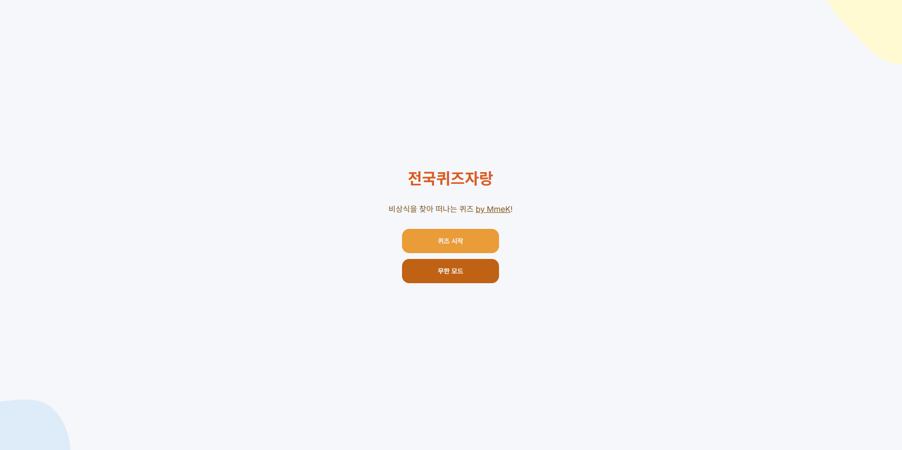
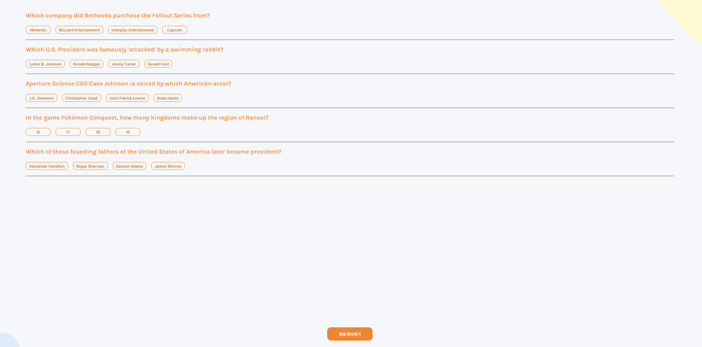
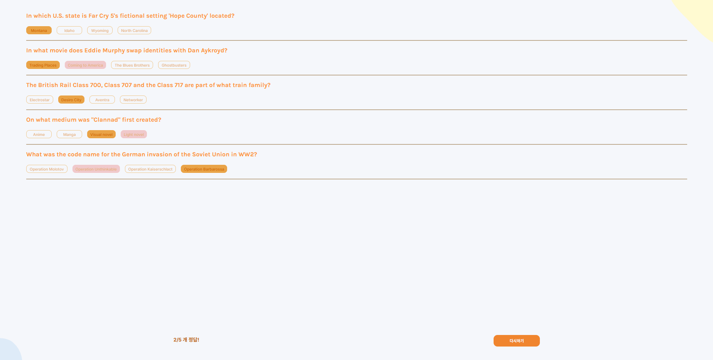

##### 원본 : https://github.com/MmeK/react-trivia

##### 버셀링크 : https://2026-oss-assign10-opal.vercel.app
선택이유 : 우선은, 다른 게임들 같은 경우 접근하기 어려울 것 같다는 인식이 높았다. 특히 스네이크같이 텍스트가 베이스가 아닌 게임의 경우엔 내가 함부로 건들였다간 꼬일가능성이 높다고 생각하여 텍스트 베이스의 예제를 찾다보니 좋은 예제를 찾은 것 같다. 

실행방법 : npm install로 설치하여 npm run dev 명령어를 입력하여 실행가능하다. 

실행화면 : 

### 수정사항
수정내용 1 : 문제를 제외한 텍스트를 한국어로 변경

수정내용 2 : CSS 변경을 통한 UI 색상 통일

수정내용 3 : 무한모드라는 새로운 모드 생성

<h3>Project structure</h3>

APP.jsx에서는, 앱의 시작화면이랑 퀴즈화면을 번갈아 전환시키고, Open Trivia DB라는 API를 통해 문제를 가져오게된다

Index.html에서는, main.jsx를 호출하며, main.jsx에서는 다시 app.jsx를 호출하여 기능을 작동시킨다. 

Components 파일 안의 Questionpage.jsx와 qeustion.jsx는 문제화면이 열린 후 선택지 및 선택한 값, 결과 화면을 관리한다. 

<h3>React Component</h3> 
QuestionPage는 Question 컴포넌트를 만들고, 각 문제가 정답인지 아닌지를 모아, 점수를 계산한다

또한 Question 컴포넌트는 선택지를 Answer 컴포넌트로 만들어서, 선택한 답을 저장하는 역할을 한다. 

<h3>Code Analysis</h3>
App.jsx 의 getQuestion 함수를 분석하였다. 

APP은 네가지의 상태로 존재하는데, 
started : 시작화면/퀴즈화면 결정

ended : 퀴즈 끝났는지 확인

questions : API에서 가져온 문제목록 저장

isloading : 문제를 불러오는중인지 확인

getQuestions가 Open Trivia DB라는 API에 요청을 보낸뒤, 응답을 JSON파일로 바꿔서 data.results를 processQuestions 에 전달한 뒤 전달값을 questions에 저장한다. 이후 로딩을 종료한다. 

started가 false면 intropage를 로딩하고
시작버튼을 누르면 started 가 true로 바뀐다

퀴즈가 시작된 후 로딩중일 시 Loading 을 보여주고
로딩이 끝나면 questionpage에 문제가 보인다. 

#### 새롭게 배운 세가지
1. node라는 개념과, vite를 이용한 로컬 호스트 주소 생성법
2. 깃허브의 fork 기능을 이용한 합법적 창작물 도둑질(?)마땅한 표현법 못찾음
3. 폴더안의 파일을 활용하는 명령어 구조 ex) src/answer.jsx

#### 어려웠던점
jsx라는게 js랑 비슷하지만 다른부분이 많아서 작업하는 중간중간 js와 구분짓지 못한점이 좀 있어, 실행에 애를먹은 부분이 있었다. 

#### AI사용처
무한모드 만들때 jsx와 js를 구분짓지못해, 오류가 생기는 지점을 찾아달라고 계속 빌었다

